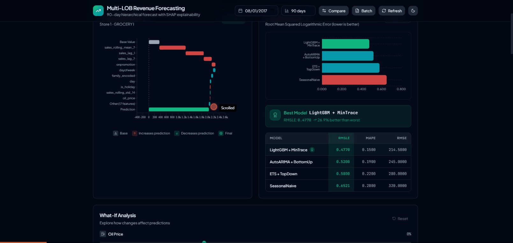

# MLRF: Store Unit-Sales Forecasting System


An experimental unit-sales forecasting prototype built from the Kaggle Store Sales dataset
(54 stores × 33 product families = 1,782 time series), with a Python training pipeline, a Go
inference API, a SHAP sidecar, and a React dashboard.

**Read [LIMITATIONS.md](LIMITATIONS.md) before evaluating this repository.** It records what is
not implemented and which numbers are not reproducible from a clean clone.

The model is a rolling one-step regressor over the dataset's `sales` (unit) target. Fixed-origin
multi-horizon forecasting is not implemented: the training label is the current row's `sales`,
never `sales[t+h]`. The system does not model revenue, prices, or currency.

## Demo



The dashboard falls back to mock data when API responses are missing, so a running demo does not
by itself demonstrate a working prediction path (see LIMITATIONS.md).

**What is implemented:**
- Polars feature engineering over store × family daily series (calendar, lag, and rolling features)
- LightGBM training with walk-forward validation splits and native categorical handling
- SHAP feature attributions, showing each displayed feature's additive contribution to the model output
- A summing-matrix hierarchy utility and standalone MinTrace/bottom-up/top-down/OLS reconciliation
  functions, which the training pipeline does not call
- A Go REST API performing ONNX inference with Redis and in-process caching

## Quick Start

```bash
# 1. Download data (requires ~/.kaggle/kaggle.json)
cd mlrf-data && pip install -e ".[dev]"
python -m mlrf_data.download

# 2. Build feature matrix
python -m mlrf_data.features

# 3. Train models
cd ../mlrf-ml && pip install -e ".[dev]"
python -m mlrf_ml.train

# 4. Start system
cd .. && docker-compose up -d

# 5. Open dashboard
open http://localhost:3000
```

## Architecture

```
mlrf-data (Python/Polars)     -> Data ingestion, feature engineering, hierarchy
mlrf-ml (Python)              -> Model training, SHAP, ONNX export (reconciliation is unused)
mlrf-shap (Python)            -> SHAP computation sidecar (HTTP JSON)
mlrf-api (Go)                 -> ONNX inference, Redis cache, REST API
mlrf-dashboard (TypeScript)   -> React + TypeScript + visx + Recharts + Tailwind CSS
```

**Data Flow**: Kaggle CSV -> Polars preprocessing -> Feature matrix -> LightGBM training -> optional SHAP artifacts -> ONNX export -> Go inference -> React dashboard

The statistical models (AutoARIMA, ETS, SeasonalNaive) exist as a standalone module that the
training pipeline never calls.

**Hierarchy**: the summing matrix contains a Total row, 54 Store aggregates, 33 Family aggregates,
and 1,782 Store × Family bottom series. Store and Family aggregates are parallel cross-sections of
the same bottom series, not a Store -> Family chain.

## API Endpoints

| Endpoint | Method | Description |
|----------|--------|-------------|
| `/health` | GET | Health check |
| `/predict` | POST | Single prediction with caching |
| `/predict/batch` | POST | Batch predictions |
| `/explain` | POST | Real-time SHAP waterfall data |
| `/hierarchy` | GET | Hierarchy tree read from a precomputed JSON artifact |
| `/admin/reload-features` | POST | Hot-reload feature store (requires `X-Admin-Key` only when `ADMIN_API_KEY` is set) |

### Example: Single Prediction

```bash
curl -X POST http://localhost:8081/predict \
  -H "Content-Type: application/json" \
  -d '{
    "store_nbr": 1,
    "family": "GROCERY I",
    "date": "2017-08-01",
    "features": [0.0, 0.0, ...],
    "horizon": 90
  }'
```

### Example: SHAP Explanation

```bash
curl -X POST http://localhost:8081/explain \
  -H "Content-Type: application/json" \
  -d '{
    "store_nbr": 1,
    "family": "GROCERY I",
    "date": "2017-08-01"
  }'
```

## API Error Responses

The documented prediction and explanation handlers return structured error responses. `/health`,
`/metrics`, and `/model-metrics` always write success JSON, and unmatched routes use the router's
default response rather than this format.

```json
{
  "error": "Human-readable error message",
  "code": "ERROR_CODE"
}
```

The error type also carries an optional `request_id` field, but nothing currently populates it:
the error helper reads a private context key that the installed chi request-ID middleware does not
set.

### Error Codes

| Code | HTTP Status | Description |
|------|-------------|-------------|
| `AUTH_REQUIRED` | 401 | API key missing or invalid |
| `INVALID_REQUEST` | 400 | Malformed request body or missing fields |
| `INVALID_STORE` | 400 | Store number is not positive. Prediction handlers do not enforce an upper bound of 54; `/historical` separately enforces 1-54 |
| `INVALID_FAMILY` | 400 | Unknown product family (matched case-sensitively) |
| `INVALID_DATE` | 400 | Date is missing or is not parseable as `YYYY-MM-DD`. No range check is performed |
| `INVALID_HORIZON` | 400 | Horizon is not 15, 30, 60, or 90. Only `/predict/simple` validates horizon; `/predict` and `/predict/batch` do not |
| `MODEL_UNAVAILABLE` | 503 | ONNX model not loaded |
| `INFERENCE_FAILED` | 500 | Model prediction error |
| `PARSE_ERROR` | 400 | JSON parsing failed |
| `SHAP_UNAVAILABLE` | 503 | SHAP service not connected |
| `SHAP_ERROR` | 500 | SHAP computation failed |
| `FEATURE_STORE_UNAVAILABLE` | 503 | Feature store not loaded |
| `HIERARCHY_UNAVAILABLE` | 503 | Hierarchy data not available |
| `RELOAD_FAILED` | 500 | Feature store reload failed |

### Example Error Response

Store 999 currently passes validation, because only non-positive store numbers are rejected. To
see the current `INVALID_STORE` behaviour, use a non-positive store number:

```bash
curl -X POST http://localhost:8081/predict/simple \
  -H "Content-Type: application/json" \
  -d '{"store_nbr": 0, "family": "GROCERY I", "date": "2017-01-01", "horizon": 30}'

# Response (400 Bad Request):
{
  "error": "store_nbr must be positive",
  "code": "INVALID_STORE"
}
```

## Development

### Python (mlrf-data, mlrf-ml)

```bash
# Setup
python3 -m venv .venv
source .venv/bin/activate
cd mlrf-data && pip install -e ".[dev]"
cd ../mlrf-ml && pip install -e ".[dev]"

# Run tests
pytest mlrf-data/tests/ -v
pytest mlrf-ml/tests/ -v

# Lint
ruff check mlrf-data/ mlrf-ml/
```

### Go API

```bash
cd mlrf-api
go build ./cmd/server
go test ./... -v
./server  # Requires ONNX model in ../models/
```

### Dashboard

```bash
cd mlrf-dashboard
bun install
bun run dev        # Development server on :5173
bun run build      # Production build
bun run typecheck  # Type check
bun run lint       # Lint
```

### Docker Compose

```bash
# Start all services
docker-compose up -d

# View logs
docker-compose logs -f api

# Stop all services
docker-compose down
```

## Performance

No latency, throughput, or accuracy benchmark results are checked in, so this README reports no
performance figures. The repository does include the tooling to produce them: `scripts/integration_tests.sh`
and the k6 suites under `mlrf-api/tests/load/` measure API latency, and the training pipeline
computes RMSLE for the current dataset and configuration. Run them in your target environment and
publish the resulting artifacts alongside any number you intend to quote.

## Data Files

```
data/raw/          # Kaggle competition files (train.csv, oil.csv, etc.) - gitignored
data/processed/    # Cleaned Parquet files - gitignored
data/features/     # Feature matrices - gitignored
models/            # Generated artifacts. .gitignore excludes selected formats
                   # (*.onnx, *.pkl, *.parquet); lightgbm_model.txt and
                   # feature_importance.csv are tracked in git
```

## Key Technical Decisions

- **Polars in the data package**: Polars expressions handle grouped lag and rolling operations;
  the ML package converts selected features to pandas for LightGBM. No pandas-versus-Polars
  benchmark is checked in.
- **statsforecast + hierarchicalforecast (Nixtla)**: Pure Python libraries used by the standalone
  statistical-model and reconciliation modules, neither of which the training pipeline calls.
- **Go + ONNX Runtime**: The API performs inference in Go via ONNX Runtime. Inference on a session
  is serialized by a mutex, and no latency benchmark result is checked in.
- **Redis with a local map cache**: Redis fronted by an in-process map with TTL expiry and
  best-effort age-based eviction. This is not TinyLFU and not LRU, and the map is not guarded by a
  mutex (see LIMITATIONS.md).
- **visx for SHAP waterfall**: Custom implementation (shapjs lacks waterfall support)

## Project Structure

```
mlrf/
|-- docker-compose.yml
|-- docker-compose.monitoring.yml
|-- LIMITATIONS.md        # What this project does not do
|-- DECISIONS-PENDING.md  # Claims removed that the owner may instead fix in code
|
|-- mlrf-data/            # Data processing (Python/Polars)
|   |-- src/mlrf_data/
|   |   |-- download.py
|   |   |-- preprocess.py
|   |   |-- features.py
|   |   |-- hierarchy.py
|   +-- tests/
|
|-- mlrf-ml/              # ML training (Python)
|   |-- src/mlrf_ml/
|   |   |-- models/
|   |   |-- reconciliation.py
|   |   |-- explainability.py
|   |   |-- export.py
|   +-- tests/
|
|-- mlrf-api/             # Go inference API
|   |-- cmd/server/
|   |-- internal/
|   |   |-- handlers/
|   |   |-- inference/
|   |   +-- cache/
|   +-- Dockerfile
|
|-- mlrf-dashboard/       # React frontend
|   |-- src/
|   |   |-- components/
|   |   |-- pages/
|   |   +-- lib/
|   +-- Dockerfile
|
|-- deploy/               # Kubernetes, Prometheus, Grafana, Alertmanager config
|-- docs/                 # Setup, deployment, model card, ADRs
|-- scripts/              # Pipeline and verification scripts
|-- specs/                # Component specifications
|-- models/               # Generated artifacts (partially gitignored)
+-- data/                 # Data files (gitignored)
```

## License

This repository does not currently include a LICENSE file, so no license is granted.
